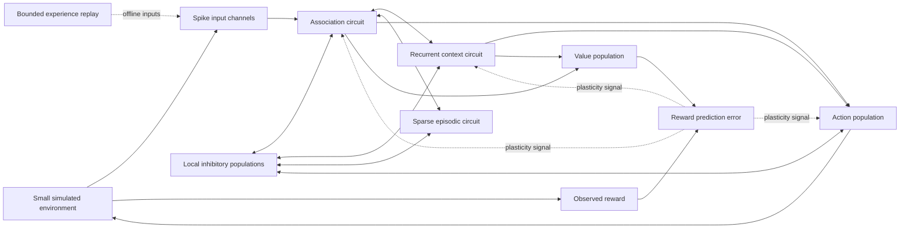

# Starting neural circuit for Cortex

Status: partially implemented research plan, 15 October 2026.

The simulator, sparse delayed wiring, trainable readouts, local conversation lab,
and controlled experiments now exist under `crates/cortex-brain/src/circuit/`.
See `BRAIN_IMPLEMENTATION_STATUS.md` and
`docs/research/brain-circuit-2026-10-15.json` for measured results and failures.
The original diagram below remains a target architecture; it is not a claim
that all its mechanisms or acceptance gates have been completed. The user chose
learning inside the new circuit and accepts limited conversation; this lab uses
no pretrained language component.

The next experiment adds surrogate-gradient training of recurrent and dendritic
synaptic magnitudes, branch gains and neuronal thresholds. One shared recurrent
core feeds an operation readout and an autoregressive English token readout;
language, mathematics and physics do not have isolated copies of the core.
This is an engineering choice, not a reconstruction of human task networks.
The original e-prop proposal below remains future work: the implemented trainer
uses approximate backpropagation through time, with detached event/reset state.
See `ml/cortex_ml/circuit/README.md` for the training and benchmark protocol.

## Objective and scope

Build a small circuit of spiking neurons with active dendritic branches,
delayed synapses, recurrent connections, inhibition, and experience-dependent
plasticity. Its first job is to learn cue-dependent actions, retain information
through delays, adapt when contingencies change, and benefit from replay.

Superintelligence is the long-term aspiration, not a deliverable or predicted
consequence of this circuit. Subjective awareness has no acceptance criterion
here. Fast learning must be measured in interactions, updates, wall time, and
retention rather than inferred from neural activity or descriptive labels.

The illustration supplies an anatomical reference. Model dendritic integration,
somatic voltage, spike generation, transmission, and synaptic adaptation.
Represent axons and myelination through transmission delays initially; omit
metabolism, nuclei, and detailed ion channels. This is an explicit computational
approximation, not a digital biological replica.

## Relationship to the current repository

The inspected `crates/cortex-brain/src/brain/cortex.rs` implements columns,
context-sensitive cells, dendritic segments, synaptic permanence, and structural
growth. Its events advance with tokens; the inspected `Cell` does not maintain
membrane voltage or a refractory state. `brain/value.rs` assigns value backward
over recent tokens; it is not a synapse-level learning gradient.

Keep that implementation as a sequence-learning reference. Introduce the new
experiment under `crates/cortex-brain/src/circuit/`, initially accessible only
from a benchmark/example. The checkout contains substantial ongoing changes;
implementation must recheck its interfaces and preserve that work. Integrate
through a small adapter only after circuit evaluation succeeds. An LLM may
eventually describe observations, but must not choose actions or provide hidden
answers in circuit benchmarks.

## Circuit topology

The expanded starting configuration has 256 external spike input channels and
1,792 simulated neurons, for 2,048 total units. These are engineering budgets,
not anatomical proportions or minimum requirements for intelligence.

| Population | Units | Initial purpose |
| --- | ---: | --- |
| Sensory input channels | 256 | Encode visible cues, proprioception, and previous actions |
| Association excitatory cells | 640 | Mixed sensory and temporal representations |
| Episodic excitatory cells | 384 | Sparse learned associations and cue completion |
| Context excitatory cells | 256 | Retain task context through delays |
| Action and value excitatory cells | 192 | 128 action cells and 64 value cells |
| Inhibitory cells | 320 | Local competition and activity regulation |

The shared inhibitory box is diagram shorthand: use local populations of 128,
64, 64, and 64 cells for association, context, episodic, and output circuits.
Value learning, decoding, replay scheduling, and reward-error calculation are
explicit algorithms surrounding the circuit, not claimed emergent abilities.

Start with 32–64 incoming connections per simulated neuron on average, allocated
across the allowed projections. Use seeded sparse wiring, with stronger local
recurrence than distant feedback; cap the expanded experiment at 150,000
synapses. No all-to-all connectivity. Begin with fixed topology and fixed
excitatory/inhibitory output signs. Tune balance from measured activity, not
solely from neuron counts. Add modules incrementally rather than enabling the
whole diagram on day one.

## Neuron and synapse model

Excitatory neurons: adaptive leaky integrate-and-fire soma plus four dendritic
compartments. Two receive feedforward input, one recurrent context, and one
feedback or memory input. Each branch has a decaying voltage/current state,
bounded coupling to its soma, and a thresholded, finite-duration plateau.
Branch location changes a synapse's effect. A compartment is a coarse branch
model, not a reconstructed morphology.

Inhibitory neurons: single-compartment leaky integrate-and-fire cells initially.
Inhibition targets both soma and selected dendrites. Spike emission resets the
soma, starts a refractory interval, and increments adaptation for excitatory
cells. Synapses have a source, target, compartment, nonnegative magnitude,
source-defined sign, delay, and decay state. Plastic synapses additionally hold
the traces needed by their selected learning rule.

Initial integration step: 1 ms; delays: integer multiples of that step, initially
1–5 ms. Starting time constants: membrane 20 ms, excitation 5 ms, inhibition
10 ms, branch state 20 ms, adaptation 200 ms, refractory interval 2 ms.
These are tunable simulation defaults, not fitted biological measurements.
Thresholds, conductances, plateau duration, and learning rates must be recorded
in configuration and calibrated with isolated-cell probes before network runs.
Compare with 0.5 ms and smaller-step reference traces before accepting 1 ms.
Set the environment action interval independently, initially 50 ms.

Use a deterministic CPU implementation first. Rust arrays store neuron and
synapse state; outgoing adjacency lists and a delay ring buffer route spikes.
No per-neuron heap objects or GPU dependency in the first experiment.

## Learning rules and responsibilities

1. Establish a frozen recurrent circuit with trainable action/value readouts.
   This separates representation quality from recurrent learning failures.
2. Train a stochastic action policy from filtered output spikes. Exploration
   samples actions; it never receives the correct action during reward-only
   trials. Train a scalar value estimate from its own output spikes.
3. At action boundaries compute the temporal-difference error
   `delta = reward + gamma * V(next_state) - V(state)`, with bootstrapping zero
   at true terminal states. Treat time-limit truncation separately. Accumulate
   neural evidence and eligibility over all intervening simulation steps.
4. Use a policy-gradient eligibility for action readouts and a value-gradient
   eligibility for value readouts. An update has the form
   `weight += learning_rate * delta * eligibility`, but each eligibility must
   be derived from its own output/loss; a generic Hebbian trace is insufficient.
5. Add recurrent learning using an explicitly derived e-prop-style estimator.
   First validate it for the soma-only model, then extend the state derivatives
   to dendritic compartments and plateau states. Check approximations against
   a small surrogate-gradient reference. Do not call an arbitrary three-factor
   STDP rule e-prop. Keep plasticity masks so readout-only and recurrent learning
   remain directly comparable.
6. Investigate gated Hebbian/STDP learning in the episodic population separately.
   Measure one-exposure association and cue completion. This is not a substitute
   for the task-directed policy learning rule, and improved episodic recall
   does not by itself demonstrate improved action learning.
7. Add slow firing-rate homeostasis and bounded weight normalization. Start
   with fixed inhibitory weights; evaluate inhibitory plasticity later. Avoid
   concurrent rules changing the same weights until their interaction is tested.

Eligibility duration must cover the task's tested delay range; use a declared
range of trace timescales rather than assuming a short spike trace remembers
arbitrarily delayed rewards. Log trace norms and weight saturation.

## First tasks and measurement gates

Use explicit vector observations first. Image recognition and language learning
would otherwise obscure whether the circuit itself can learn.

| Stage | Experiment | Evidence required to advance |
| --- | --- | --- |
| A | Isolated soma, branch, synapse, and inhibitory pair | Expected decay, reset, refractory interval, delay, compartment specificity, and plateau termination; no NaNs |
| B | 128 excitatory + 32 inhibitory cells, fixed wiring | Bounded non-synchronous activity under silence, normal drive, and an input burst; recovery after the burst |
| C | Two cues, two actions, immediate reward | At least 90% held-out accuracy on the defined task; beats shuffled-reward and frozen-learning controls |
| D | Cue, blank delay, then choice | At least 85% at the preregistered training delay; beats a memoryless policy; report the full delay-performance curve |
| E | Reverse cue/reward mapping | Measure interactions to recover 85%, old-task retention, and differences from learning the new mapping from scratch |
| F | Related but unseen cue combinations | Transfer improvement over scratch training with equal exposure budgets; failure does not invalidate earlier narrow results |
| G | Offline replay between tasks | Better retention or adaptation at equal total update and compute budgets |

The percentages are proposed project gates, not predicted results. Freeze task
definitions, delays, maximum interaction budgets, and tuning budgets before
the final evaluation. Report all ten evaluation seeds, mean, spread, confidence
intervals, and failed runs. Select hyperparameters on separate development
seeds. A failed gate triggers diagnosis or a simpler model, not more neurons.

Baselines: random policy, memoryless learner, compact non-spiking recurrent
learner, frozen spiking reservoir with learned readout, and the circuit with
learning disabled. Compare dendritic cells with a soma-only circuit at matched
parameter counts as well as comparable compute. Use the current Cortex sequence
learner where task encodings and action interfaces can be made comparable;
document any external memory or decoder it requires.

Measure learning curves, interactions to criterion, forgetting, generalization,
firing rates, saturation, bytes used, updates, and wall time. Show resource
budgets when reporting faster learning. Publish all planned ablations, including
those that remove dendritic nonlinearity, adaptation, recurrence, or replay.

## Replay, growth, and later cognitive experiments

Initially replay bounded, recorded observation/action/reward sequences to train
representations or value estimates. Replaying a stored action is not a new
on-policy sample: freeze the actor during offline replay until an explicit
off-policy correction is implemented and validated. Keep replay provenance.

Introduce growth/pruning only after fixed-topology learning and retention work.
Use a separate experiment with fan-in and total-memory caps, protected recent
learning, and an equal-budget fixed-topology control. Avoid neuron birth in the
first implementation; staged neuron addition is a later experimental feature.

### Bounded growth toward one million neurons

User-selected ceiling: 1,000,000 live simulated neurons, including inhibitory
cells; external input channels do not count as neurons. This is a hard maximum,
not a target the system must reach. Default to the original 1,792-neuron learning
configuration after the 160-neuron dynamics check. Use four branches per
excitatory cell and no explicit branches on inhibitory cells initially.

Maintain a starting mean fan-in near 64 connections per neuron, with a maximum
of 256 per target and an independent hard limit of 64,000,000 live synapses.
Allow at most four branches per excitatory neuron: the one-million-neuron
ceiling therefore implies no more than four million explicit branch states.
Keep limits configurable downward. Allocation, restore, and growth operations
must enforce all caps; reject oversized snapshots before large allocations.
Include spare capacity, adjacency indices, traces, replay, pending spike queues,
and checkpoint working space in a separate byte budget. A neuron cap alone
does not bound memory. Bound event queues and telemetry as well.

Illustrative compact storage at the final synapse cap: 64 million synapses at
32–48 bytes per synapse occupy 2.048–3.072 GB (decimal). The byte assumption
includes a compact record and a small selected set of traces, not arbitrary
eligibility state. It excludes the other allocations above. Measure actual
layouts and peak RSS; this calculation does not establish a device's capacity
or real-time performance. At a mean 1 Hz and 64 outgoing connections per
neuron, one million neurons deliver about 64 million synaptic events per
simulated second; membrane and branch integration add independent work.

Use 1,792, 8,192, 32,768, 131,072, 524,288, and 1,000,000 as evaluation
milestones, not single jumps. Between milestones add small batches, at most
10% of live neurons per decision, preserving the local excitatory/inhibitory
allocation. Trigger growth only after repeated development-set evidence of a
capacity bottleneck, such as representation interference alongside high usage
of available branches. First rule out poor learning signals, unstable dynamics,
or insufficient experience. Never grow based on held-out evaluation outcomes.

Initialize new connections weakly, ramp their influence over a recorded
adaptation interval, retain existing learned weights, and compare against the
pre-growth checkpoint on development tasks and retention probes. Roll back
growth that harms retained skills or exceeds resource budgets. At the ceiling,
continue learning and bounded rewiring without adding neurons. Reuse slots
only after all old connections, queued events, and traces are cleared or
invalidated with generation identifiers. Checkpoint topology changes atomically.

For associative excitatory projections, begin with approximately 70% of the
connection budget within a module, 20% between adjacent processing modules,
and 10% for longer feedback/memory projections. This is a tunable wiring prior,
not an optimum. Sensory, action, and inhibitory projections follow their
declared roles instead. Keep local inhibitory feedback, recurrence, feedforward
paths, and selected return paths; compare alternatives at matched budgets.

Later, learn action-conditioned predictions and compare short imagined rollouts
against direct action selection. Keep imagined trajectories separate from
observed episodes and never promote generated rewards into observed evidence.
Only then investigate fast predictions versus deliberation, calibrated
confidence, and replay with generated trajectories. These are functional tests
of intuition, planning, and self-monitoring; they do not certify consciousness.

## Implementation sequence and deliverables

1. Record the current baseline and create an isolated circuit API/configuration.
   Define units, clocks, seeds, observation boundaries, and evaluation budgets.
2. Implement `neuron.rs`, `dendrite.rs`, `synapse.rs`, and `network.rs`; finish
   isolated dynamics and small-network stability tests before task learning.
3. Add `encoding.rs`, `task.rs`, and `decode.rs`; deliver the frozen-circuit
   cue/action benchmark with observable spikes and no hidden-answer inputs.
4. Add `plasticity.rs`; deliver action/value learning and delayed-cue evaluation,
   first with frozen recurrence, then with derived recurrent eligibility.
5. Add episodic learning and `replay.rs`; run reversal, retention, and replay
   comparisons. Expand toward the 1,792-neuron configuration only as needed.
6. Add versioned `snapshot.rs` and compact telemetry; verify exact continuation
   across save/load, including RNG, traces, pending spikes, and clocks. Separate
   reset-of-episode state from reset-of-learned-weights semantics.
7. Expose an experimental adapter to the existing brain service and inspector
   after the selected learning gates pass. Label neural activity and measured
   capabilities directly. Keep benchmark execution independent of the GUI.
8. Produce a reproducible report and review changed code for numerical errors,
   learning/evaluation leakage, broken persistence, stale synapse references,
   and unbounded allocation. Run relevant Rust tests and integration checks;
   distinguish pre-existing checkout failures from new regressions.

Each deliverable includes its configuration, command, checkpoint where relevant,
metrics, seed list, and pass/fail decision. No calendar promises until a small
CPU benchmark establishes simulation and training costs.

## Research references and their limits

- Gidon et al., *Dendritic action potentials and computation in human layer 2/3
  cortical neurons*: https://pubmed.ncbi.nlm.nih.gov/31896716/ — evidence for
  nonlinear dendritic computation, not a recipe for general intelligence.
- Bellec et al., *A solution to the learning dilemma for recurrent networks of
  spiking neurons*: https://www.nature.com/articles/s41467-020-17236-y — basis
  for investigating eligibility propagation; it does not validate this proposed
  compartment model without an additional derivation and tests.
- Sacramento et al., *Dendritic cortical microcircuits approximate the
  backpropagation algorithm*: https://arxiv.org/abs/1810.11393 — a research model
  for compartment-specific learning signals, not a drop-in learning rule for
  the proposed spiking circuit.

First concrete milestone: a small, stable neural circuit that learns a two-cue
decision task and then retains the cue through a delay, with learning and memory
controls showing which mechanism made the difference.
