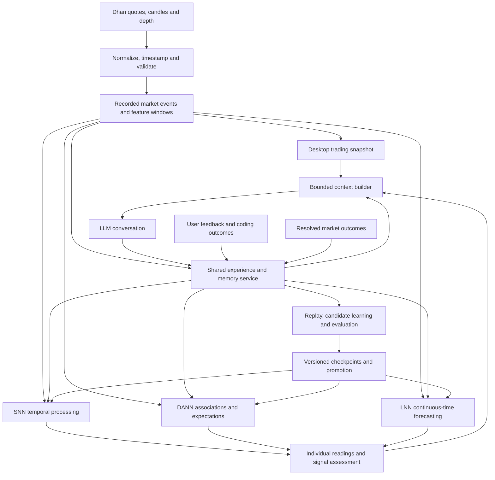

# Desktop trading chat, shared memory, and adaptive neural abilities

Status: implementation plan only. Prepared 14 October 2026 from the current Cortex checkout. Application changes and runtime validation have not started.

## 1. Intended experience

On every desktop trading tab—Chart, Forecast, Outcomes, and Metrics—the user can hide/show the left navigation and open/close a resizable chat sidebar on the right. Charts keep running while chat is open. Panel choices survive restart and do not change the layout preference for coding chats.

The user chats with the configured LLM about signals, market conditions, previous conversations, or other subjects. The LLM receives current screen data, individual SNN/DANN/LNN readings, their measured records, and relevant long-term memories. Each response identifies the instrument, timeframe, data timestamp, and memories it used. Neural readings remain individually inspectable alongside the conversation.

Dhan depth and order-flow observations appear on the screen and enter the same context pipeline used by the models. Conversations, observations, forecasts, feedback, resolved outcomes, and learning checkpoints remain accessible after restarting. SNN, DANN, and LNN can retrieve relevant experience through a shared memory service and use compatible representations for learning.

Scope: desktop first. Implement desktop wiring in `cortex-gui`; additions to shared crates must preserve existing mobile/remote behavior through additive APIs and explicit opt-in. No Android, iOS, mobile UI, or remote protocol rollout in this work. Existing research/signals behavior continues without order execution.

## 2. What exists and what is missing

These are source observations, not confirmation that the current working tree builds or that authenticated feeds are live.

| Component | Current source | Required extension |
| --- | --- | --- |
| Trading screens | `crates/cortex-gui/src/views/trading/` has Chart, Forecast, Outcomes, Metrics | Right chat panel, depth view, memory access, independent panel persistence |
| Left navigation | `app.rs` has `sidebar_open`; `workspace.rs` handles Command-B | Preserve toggle; add trading-specific layout state and visible restore controls |
| Market runtime | `cortex-market/src/market.rs` maintains a revisioned snapshot and background work | Shared desktop service, richer timestamped context, scoped subscriptions |
| Dhan | History, quotes, live full-feed parser including five-level depth | Dedicated deeper-depth connection/parser, full book retention, feature recording |
| Screen depth data | Snapshot exposes best bid/ask, spread and displayed totals; `apply_depth` retains best prices | Retain both book sides with independent freshness and coverage |
| Trading LLM | `llm.rs`/`oracle.rs` make a single JSON candle forecast request | Streaming multi-turn chat, memory retrieval, model readings and live context refresh |
| Neural forecasts | `cortex-liquid/src/path.rs` runs LNN, DANN, SNN and an ensemble on bars | Order-flow inputs, memory adapters, persistent learning and separate signal horizons |
| SNN | `spiking.rs` is a fixed seeded LIF reservoir with a trained linear readout | Tested plasticity, structural adaptation, reusable abilities and durable state |
| DANN | `regime.rs` uses a growing dendritic network from `cortex-living` | Richer domain percepts, shared experience retrieval and capability evaluation |
| LNN | CfC cell learns continuous-time candle features | Incremental learning, richer features, persistent state and evaluated expansion |
| Memory | `cortex-memory` stores scoped SQLite episodes, facts, lessons and recall records | Trading schemas, conversation storage, model/event links, searchable domain context |
| Coding brain | `cortex-brain` controllers/intuition, `cortex-living` and optional Mind service | Typed domain adapters; distinguish these components from the market forecasters |

Existing `Market::train` trains from a bounded bar window and periodically retrains. Recurrent state and retraining do not establish long-term learning from chat or shared memory. The current trading LLM brief includes candles and selected indicators; it does not provide the requested conversational integration.

The working tree contains substantial existing changes. Implementation must start by recording the baseline and preserve those changes.

## 3. Shared data and experience flow

Use a shared desktop runtime rather than a separate Dhan connection and learning owner for every chat pane. Each consumer has its own instrument/timeframe subscription and generation ID. Switching instruments cannot deliver an old answer, book, or training result into the new screen. Multiple panes watching one instrument reuse subscriptions within the connection budget.

Proposed types: `MarketContext`, `DepthSnapshot`, `FlowFeatures`, `ExperienceEvent`, `MemoryRef`, `NeuralReading`, `SignalAssessment`, and `ModelCheckpoint`. Names are implementation proposals, not existing APIs.

Every reading carries domain, exchange segment/security ID, timeframe, horizon, source, event/receive timestamps, feature version, model version, missing-data mask and evidence references. Context captures one coherent revision, with explicit ages for components that arrive independently.

## 4. Desktop layout and conversational chat

1. Add visible left-navigation and right-chat toggles to the trading header. Keep Command-B for the left sidebar; add a nonconflicting chat shortcut after checking existing bindings.
2. Persist trading layout separately: left visibility, right visibility and width. Both panels remain restorable when hidden. Narrow windows use a closable overlay; the composer stays reachable.
3. Build a dedicated `TradingChat` session using the existing provider configuration and conversation/composer rendering where suitable. Its history is separate from the coding worker, and switching trading tabs preserves it.
4. Support streaming, stop/cancel, retry, provider errors, history search and reopening older sessions. Hiding chat does not cancel a request; Stop does.
5. Keep natural-language conversation and JSON forecast requests as separate provider request modes. Preserve the existing LLM forecast option.
6. Show compact SNN/DANN/LNN cards for direction, horizon, uncertainty, evidence and disagreement. These are network outputs explained by the LLM; the networks are not presented as independently fluent chat models.
7. Allow free discussion in trading chat. Questions about another instrument either explicitly subscribe to it or state that its data is unavailable. Coding discussion can retrieve coding memories; it does not silently launch the coding agent.

At each user turn, capture fresh context: instrument, interval, closed/forming candles, indicators, levels, available depth/flow, every network's latest reading, outcomes, current forecast/plan, selected chart range and relevant history. All screen data is addressable through bounded read-only context APIs; large datasets are queried in slices rather than copied wholesale into every prompt.

Provide read-only operations for current snapshot, candle ranges, book/flow windows, individual readings, outcome records and memory retrieval. The LLM can refresh these during a longer turn. After an answer finishes, mark when the screen has advanced beyond its context revision and offer Refresh; do not claim that a response remains continuously current while prices change.

Use explicit context budgets and timeouts. Prioritize the current question, fresh state, selected evidence, neural disagreement and relevant memory. Record omissions. Ingest ticks continuously; call the LLM on user requests or deliberate signal events, with deduplication and rate limits.

## 5. Dhan depth and order-flow integration

Dhan documents a regular Full packet with LTP, LTQ, LTT, volume, OI and five-level depth. Use the [official live-feed specification](https://dhanhq.co/docs/v2/live-market-feed/) for decoding.

Dedicated depth streams support 20 or 200 levels for NSE equity/derivatives. The documented subscription limits are 50 instruments per 20-level connection and one per 200-level connection. Bid and ask packets arrive separately. Use the [official full-depth specification](https://dhanhq.co/docs/v2/full-market-depth/) and validate actual account availability before enabling each mode.

Implementation:

- Preserve the regular feed; add `dhan/depth.rs` and a shared subscription coordinator. Default to available 20-level coverage; expose 200-level mode when supported. Show five-level fallback and unavailable states explicitly.
- Decode concatenated binary packets, validate sizes, sides, instrument identity, quantities and prices. Timestamp bid and ask sides separately. Do not assume matching sequence numbers or guaranteed gap detection where the protocol does not provide them.
- Reset stale book state on reconnect/session changes; implement heartbeat, capped reconnect backoff, cancellation and visible stale/partial status. Keep credentials out of prompts and recordings.
- Record received events in an append-only local archive with bounded ingestion buffers, gap markers, retention controls and compressed storage. Keep searchable experience metadata in SQLite. Historical candles must not be assigned fabricated historical depth.
- Derive spread, depth imbalance, microprice, near-price liquidity concentration, displayed-liquidity changes, volume changes, update intensity and volatility over explicit windows. Each feature includes coverage and quality flags.
- Any inferred trade direction or flow delta is labeled a proxy. Last-trade fields and aggregated book updates alone do not prove a complete aggressor-tagged trade tape, individual cancellations, order lifetimes or participant intent. Verify packet coverage before supporting stronger claims.
- Add a depth ladder, liquidity/imbalance view and compact flow timeline to the trading screen, using the same feature values consumed by models and chat.

Separate short-horizon flow signals from candle forecasts. Candle models consume causal window summaries; an event model may consume finer timing. Their horizon labels and evaluation must remain distinct. Incompatible or missing depth uses an explicit candle-only model, rather than zero-filled flow presented as observed data.

## 6. Shared long-term memory

Extend `cortex-memory` with a domain-aware experience API and migrations; avoid pushing trading experiences through file-existence checks intended for coding episodes.

Persist:

- Full user/assistant conversation, attachments by reference, session IDs and the context revision used for each answer.
- Observations and source references; predictions from each model, uncertainty, disagreements and decision explanations.
- Feedback, corrections, preferences, resolved outcomes, failed hypotheses and reusable lessons.
- Learning lineage: replay selections, training ranges, candidate metrics, structural changes and promoted checkpoints.
- Neural checkpoints containing topology, weights, feature/scaler versions, dimensions and compatible recurrent state. Store raw high-frequency observations in the market archive and link them from memory.

Use `trading`, `coding` and `general` domain tags plus narrower scopes such as instrument, interval, repository and task. All networks share the memory API, with relevance and compatibility filters. Verified general lessons may transfer across domains; instrument-specific market facts and repository facts keep their scope.

Distinguish observation, user belief, model hypothesis, imagined scenario and verified outcome. A persuasive answer or positive user reaction is not proof of prediction accuracy. Maintain provenance, corrections/supersession, and an `available_at` timestamp so historical evaluation cannot retrieve future lessons or later outcomes.

LLM retrieval uses bounded summaries and source excerpts. Neural adapters convert compatible experiences into structured features, percepts or embeddings. Raw prose is stored, but it cannot be treated as input to the existing numeric forecasters without a representation layer. Validate any LLM-extracted lessons against the original text before using them as training evidence.

Expose memory search, source inspection, filters by domain/model/symbol/time, “what did we learn?”, and explicit memory notes from chat. Persist messages incrementally; recover after crashes. Missing embeddings fall back to lexical retrieval. Storage failure is visible so the user knows which events were not saved.

## 7. Explicit SNN and DANN abilities

The user's additional requirement is that SNN and DANN gain useful abilities, beyond chart prediction. Give each a callable capability interface with typed inputs, outputs, evidence and measured reliability. The LLM explains results and coordinates permitted tools; neural components supply learned state, estimates and proposals.

| Ability | SNN implementation direction | DANN implementation direction | Proof required |
| --- | --- | --- | --- |
| Sense environment | Encode market events and coding event timing into temporal inputs | Encode domain, context and combinations into percepts | Detect scripted state changes with measured misses/false alarms |
| Recognize domain | Domain-conditioned encoder and state | Namespaced percepts and domain-specific associations | Mixed coding/trading evaluation without cross-domain contamination |
| Recall experience | Retrieve episodes and encode compatible temporal patterns | Retrieve associations, lessons and prior expectations | Recover relevant evidence after restart; cite source IDs |
| Anticipate changes | Learn temporal precursors and anomaly scores | Learn sequences and conditional expectations | Chronological held-out prediction against simple baselines |
| Apply intuition | Rank familiar patterns by learned outcome evidence | Offer association-based hunches and likely next states | Useful-hunch rate and calibrated abstention |
| Learn from feedback | Update eligible readouts/weights from settled outcomes | Update branch/value evidence from verified outcomes and corrections | Adaptation plus retention on previously learned cases |
| Imagine alternatives | Roll out through a separately validated transition model | Reuse `imagine_after`-style associative rollouts | Compare imagined outcomes with subsequently observed ones |
| Propose a plan | Score candidate action/state sequences using learned estimates | Compose supported transitions toward an explicit goal | Feasible plans outperform a baseline on bounded tasks |
| Support reasoning | Supply temporal evidence, alternatives and uncertainty | Supply conditional associations and evidence paths | Trace conclusions to observations; reject unsupported chains |
| Inspect results | Request snapshot/history/check-result reads through typed proposals | Request memory, outcome or evidence lookups through typed proposals | Correct scope, bounded queries and visible result/error handling |
| Evolve structure | Add/prune units and connections within budget after evaluation | Grow/prune useful neurons, branches and synapses | Improvement survives validation, restart and rollback |

Trading examples: flag changing liquidity, compare similar historical regimes, explain model disagreement, propose confirmation/invalidation conditions, and learn from the realized horizon.

Coding examples: recognize repeated failure sequences, retrieve a relevant fix, anticipate a check failure, rank diagnostic steps, and learn from actual compiler/test/tool outcomes. Add coding task adapters and suitable prediction heads; do not reuse the candle forecasting head to interpret code.

Planning and imagination begin with bounded environments and explicit available actions. Associative rollouts are hypotheses; stronger counterfactual planning needs a validated transition model and checked constraints. Arbitrary tool arguments and reliable general reasoning are not assumed from network growth. Shell/edit actions continue through the existing coding tool and approval system.

“Environment awareness” here means maintaining state about the current domain, fresh observations, expectations, uncertainty and prediction errors. Subjective awareness or consciousness is not a deliverable. Increasing neuron count alone is not evidence of intelligence.

## 8. LNN abilities and continual evolution

All three networks can consume shared observations, retrieve compatible experience, provide independent predictions, receive feedback and participate in replay. LNN specializes in continuous-time dynamics, changing volatility and evolving numeric state; it also needs separate coding/general adapters before those abilities extend beyond market features.

Keep retrieval, learning and structural growth separate:

1. **Retrieval:** every model can access useful existing memory without changing weights.
2. **Learning:** delayed, verified outcomes update a candidate model using recent and retained experiences.
3. **Structural adaptation:** budgeted growth, pruning or rewiring is considered when supported by measured need.

Network work:

- **SNN:** establish the fixed-reservoir baseline; add persistent online readout updates first. Introduce bounded plastic connections and recruitment/pruning as evaluated candidates, with stable firing statistics and parameter limits. Resize readouts and state safely when topology changes.
- **DANN:** preserve existing growth/pruning mechanisms, extend percepts for depth, dialogue-derived lessons and coding events, and add domain-conditioned outcome feedback. Inspect whether useful associations retain old abilities.
- **LNN:** add persistent incremental training with replay. Width expansion requires compatible state/weight migration or candidate retraining/distillation; it is not currently an existing rewiring feature.

Resolve market labels only when the requested horizon matures. Score a prediction before learning from its outcome. Coding labels come from actual checks and structured feedback. Dialogue changes memory immediately; it changes model weights only through a validated learning path.

Replay mixes recent, surprising, corrected and older verified experiences within CPU/memory/time budgets. Historical replay teaches from real outcomes. Imagined rollouts remain separately tagged and cannot become observed truth or inflate accuracy. Train in background, pause when responsiveness requires it, and use hard limits for neurons, branches, connections and archive growth.

Publish model/topology/scaler/index manifests atomically. Track consumed event IDs and label maturity to avoid duplicate learning on restart. Failed training preserves the active generation. Promote candidates only if they improve an agreed primary metric without unacceptable regression in calibration, runtime or older tasks. Keep rollback checkpoints.

Show active/candidate versions, learning state, recent verified improvement, forgetting/regression, replay count, neuron/connection counts and last checkpoint. Report a component as inactive when its service or adapter is unavailable.

## 9. Implementation phases and completion gates

| Phase | Work | Completion gate |
| --- | --- | --- |
| 0 — Baseline | Inspect existing changes; record build/tests and current model metrics; probe account feed capabilities without exposing credentials | Known baseline and explicit unavailable features |
| 1 — Desktop chat | Panel toggles/persistence, streaming conversation, coherent screen context and model cards | Chat works beside every trading tab, restart restores history/layout, market stays responsive |
| 2 — Shared memory | Typed schemas, migration, incremental persistence, retrieval, provenance and memory browser | All three models and LLM retrieve compatible experiences; no coding/trading leakage |
| 3 — Order flow | Deeper depth parsing/subscriptions, recorder, freshness, features and screen displays | Recorded/live packet evidence matches screen, context and model inputs |
| 4 — Neural abilities | Capability interfaces, domain encoders, memory adapters, anticipation, intuition, planning and inspection | Each advertised SNN/DANN ability has a repeatable evaluation and visible status |
| 5 — Adaptive learning | Persistent SNN/LNN updates, DANN extension, replay, checkpoint lineage and bounded structural changes | Candidate gains validated; retention, recovery and rollback pass |
| 6 — Signals | Calibrated individual/ensemble assessments, disagreements, confirmations, invalidations and chat refresh | Forecasts scored before learning; stale/unsupported state abstains |
| 7 — Desktop verification | Fault checks, profiling, current-source release build and normal configured-provider launch | Native desktop flow verified end to end; no mobile rollout |

The first usable checkpoint is Phase 1: working desktop chat with screen context and existing neural readings. Phase 2 provides durable shared experience; Phase 3 adds order flow; later phases establish and measure the new neural abilities.

## 10. Validation and bug checks

Test the actual data and learning boundaries:

- Feed parser fixtures for malformed/truncated/concatenated packets, separate sides, invalid prices, changing instruments and reconnects. Verify book coverage and stale flags rather than connection status alone.
- Deterministic recorded-event replay: screen values, neural inputs and LLM context agree for the same revision. Missing book data remains missing.
- Concurrent panes, rapid symbol/timeframe switching, old provider replies, cancelled training and overlapping configuration changes cannot overwrite newer state.
- Database migration, duplicate delivery, crash during message/checkpoint writes, full disk, embedding outage, archive gaps and recovery preserve committed history or show a clear failure.
- Domain retrieval and replay isolation, point-in-time memory queries, future-label exclusion, feature/scaler fit boundaries and overlapping forecast-horizon embargoes.
- Compare candle-only versus flow-enhanced models, individual networks versus ensemble, memory on/off, replay on/off, and fixed versus adaptive topology. Use chronological walk-forward evaluation and a later untouched test period.
- Report directional balanced accuracy, forecast error, calibration, interval coverage, false alarms, abstention, sample counts, runtime and retained-task performance against simple baselines. Cost-aware paper signal evaluation is a separate gate; model complexity does not establish a trading edge.
- Exercise every advertised neural ability on held-out trading and coding tasks, including cases where the correct response is uncertainty or no proposal.
- Run a market-session soak with chat, recording and learning active; inspect queue drops, memory growth, locks, UI pauses and checkpoint latency. Set budgets from baseline measurements.
- Native checks: panel restore controls, minimum window sizes, streaming/Stop, remembered context, memory lookup, market closed/stale states, pending coding approvals and provider failure recovery.

During implementation, run tests for touched crates (`cortex-market`, `cortex-liquid`, `cortex-memory`, `cortex-living`, `cortex-gui`), relevant brain/core tests when their interfaces change, formatting and targeted Clippy. Build the current source with `cargo build --release -p cortex-gui` and verify the normal configured-provider app. Stand-in/replay tests are labeled separately from authenticated live Dhan verification.

## 11. Initial code boundaries

- `crates/cortex-gui/src/app.rs`, `workspace.rs`, `views/top_bar.rs`, `views/trading/`: layout, shared runtime ownership, chat and depth rendering.
- New desktop trading-chat worker/session: provider streaming, cancellation and context refresh; reuse presentation components where possible.
- `crates/cortex-market/src/market.rs`, `dhan/`, `llm.rs`, `oracle.rs`, `outcomes.rs`: richer snapshots, depth, recorder, read APIs and outcome events.
- `crates/cortex-memory/src/`: domain experience storage/query, provenance and migrations.
- `crates/cortex-liquid/src/features.rs`, `path.rs`, `spiking.rs`, `regime.rs`, `cfc.rs`: representation adapters, flow features and persistent learning.
- `crates/cortex-living/src/network/`, `percept.rs`, and relevant `cortex-brain` adapters: capabilities, domain separation, imagination, feedback and bounded structural adaptation.

Keep market ingestion, database work, model learning and provider calls off the UI thread. Add compatibility adapters instead of conflating the coding controller, market SNN, dendritic network and LLM into one undocumented component.
